# HiSem-VRAG: Hierarchical Semantic Retrieval for Long-Form Video Question Answering

Official code for the paper **"Hierarchical Semantic Retrieval for Long-Form Video Question Answering"**, which introduces **VRAG**, a hierarchical, coarse-to-fine retrieval-augmented framework for question answering over long-form instructional videos. VRAG organizes every video as **Video → Topics → Scenes → Frames**, narrows the search space one level at a time, and hands only a small, temporally grounded evidence set to a language model.

**Authors:** Krishil Parikh, Krisha Maisheri, Keyush Nisar, Aruna Gawade, Nilesh Rathod, Angelin Florence, Ragini Mishra.
Department of Artificial Intelligence and Machine Learning, Dwarkadas J. Sanghvi College of Engineering, Mumbai, India.

| Headline result on YouCook2 (463 videos, 1,103 queries) | |
|---|---|
| Video Recall@1 / @3 | **42.2%** / 62.9% |
| Topic Recall@1 / @3 / @5 | 55.2% / 84.0% / **91.6%** |
| Scene Recall@3 | **57.0%** (oracle upper bound 57.9%) |
| Gain from hierarchy (Video Recall@1 vs. flat retrieval) | **3.7x** (42.2% vs. 11.2%) |
| End-to-end latency | 2.65 s average, 2.59 s median |

> All figures below are animated SVGs that replay on a loop. They are regenerated from the same data as the figures in the paper.

## Contents

1. [Why hierarchical retrieval](#1-why-hierarchical-retrieval)
2. [The method in depth](#2-the-method-in-depth)
3. [Experimental setup](#3-experimental-setup)
4. [Results](#4-results)
5. [Reproducing the results](#5-reproducing-the-results)
6. [Repository layout](#6-repository-layout)
7. [Demo web application](#7-demo-web-application)
8. [Limitations](#8-limitations)
9. [Citation and license](#9-citation-and-license)

---

## 1. Why hierarchical retrieval

Instructional videos run for minutes and contain many distinct stages (preparing, mixing, cooking, plating). A question such as *"When should heavy cream be added while preparing the dish?"* is not answered by finding the right video. The system has to:

1. find the right **cooking stage** (a topic),
2. localize the right **visual segment** inside that stage (a scene), and
3. pick the **frames** that actually show the action (keyframes).

Existing video-RAG systems mostly rank videos, clips or transcript windows in a single flat step. Flat retrieval has four recurring problems on long procedural videos:

- **Long temporal span.** Exhaustive frame-level scoring is expensive.
- **Multi-step queries.** One question can touch several stages that sit far apart in time.
- **Cross-modal gaps.** Some facts are spoken (quantities), others are only visible (technique).
- **Broken continuity.** Fixed-length chunks cut procedures in the middle, so retrieval returns text that is related but temporally wrong.

VRAG replaces single-stage ranking with progressive refinement. Each stage removes most of the remaining search space before the next, more expensive stage runs.

**Contributions**

- A hierarchical coarse-to-fine retrieval framework: topic retrieval, scene refinement, keyframe selection.
- **Sub-question decomposition** that turns a complex query into focused retrieval units.
- **Gaussian-smoothed keyframe localization** that suppresses frame-level similarity noise and yields temporally stable evidence.
- A 463-video, 1,103-query benchmark on YouCook2 with full ablations at video, topic and scene level.

---

## 2. The method in depth

Formally, the system learns a retrieval function that returns a compact evidence set, and a generator turns that set into an answer:

$$R(q, \mathcal{V}) \rightarrow \mathcal{E}, \qquad a = G(q, \mathcal{E}).$$

The work splits into an **offline** stage that builds the hierarchy once and an **online** stage that answers queries.

### 2.1 Offline stage: building the hierarchical memory

<p align="center"></p>

Each video is split into an **audio stream** and a **visual stream** that are processed in parallel.

**Audio stream (text hierarchy)**

| Step | What happens | Script |
|---|---|---|
| ASR | WhisperX large-v3 produces a time-aligned transcript $\mathcal{T}=\{(t_1,\tau_1),(t_2,\tau_2),\dots\}$. | `phase_1_2_asr_whisperx.py` |
| Chunking and merging | The transcript is cut into 20 to 40 second windows. Adjacent windows are merged when their MiniLM similarity exceeds 0.75. | `phase_1_3_chunk_transcripts.py` |
| Text embeddings | Each chunk is embedded with all-MiniLM-L6-v2 (384-d). | `phase_1_4_embed_chunks.py` |
| Topic segmentation | A topic boundary is placed where adjacent chunks stop being similar (threshold 0.68), with a 60 second minimum topic duration. A topic is $S_j=(\text{start}_j,\text{end}_j,\text{text}_j)$ and corresponds to one major instructional step. | `phase_2_1_topic_segmentation.py` |

**Visual stream (scene hierarchy)**

| Step | What happens | Script |
|---|---|---|
| Frame extraction | Frames are sampled uniformly at 1 FPS, $\mathcal{F}=\{f_1,\dots,f_T\}$, each with a timestamp so evidence stays temporally grounded. | `phase_3_1_extract_frames.py` |
| Frame embeddings | Every frame is encoded with SigLIP so400m, $\mathbf{v}_i=\mathrm{Enc}_{\text{vision}}(f_i)\in\mathbb{R}^{1152}$, and L2-normalized. | `phase_3_2_embed_frames.py` |
| Scene clustering | Inside each topic span, frames are grouped by visual similarity with HDBSCAN (`min_cluster_size`=5, `min_samples`=3). Each cluster is a scene $c_{jk}$ with start/end times, frame indices and an aggregated embedding. A scene is a visually coherent sub-event such as chopping, mixing or plating. | `phase_3_3_scene_clustering.py` |

**Memory and index**

- `phase_4_build_memory_store.py` writes one structured memory per video: topic IDs and time ranges, the scenes under each topic, frame indices and embeddings, transcript embeddings, and temporal adjacency links between topics and scenes. The result is the hierarchy Video → Topics → Scenes → Frames.
- `phase_5_0_build_global_index.py` embeds every topic, $\mathbf{s}_j=\mathrm{Enc}_{\text{text}}(\text{text}_j)$, and stores all topics of all videos in **one global FAISS `IndexFlatIP`**. Because embeddings are L2-normalized, inner product equals cosine similarity.

This is the key to cross-video retrieval. Only **topics** live in the global index (1,449 vectors for 463 videos), so a query searches a small, semantically meaningful set instead of every frame.

### 2.2 Online stage: query-time hierarchical retrieval

<p align="center"></p>

`phase_5_query_pipeline_openrouter.py` implements the eleven steps in the figure.

**Steps 1 and 2. Query decomposition.** An LLM splits the query $Q$ into up to four sub-questions, $Q\rightarrow\{q_1,\dots,q_n\}$. For *"How do you prepare the dressing for the salad?"* the sub-questions target the ingredients, the order of steps and the timing. Each sub-question points retrieval at a different facet of the same video.

**Step 3. Topic-level retrieval.** The original query and every sub-question are embedded with the lightweight text encoder. Each embedding retrieves its top-K topics from the global index and the results are merged into one candidate pool

$$\mathcal{T}_{\text{cand}}=\bigcup_{i=0}^{n}\mathrm{TopK}\big(\mathbf{e}^{\text{sem}}_{q_i}\big),$$

where $i=0$ is the original query. Topics below a similarity threshold are discarded to remove noise.

**Step 4. Top videos and topics.** The pool is reduced to the best 3 videos and the best 3 topics per video.

**Cross-modal alignment.** Text-only similarity cannot ground visual detail. For fine-grained grounding the query is **re-encoded with the text tower of SigLIP**, $\mathbf{e}^{\text{vis}}_Q=\mathrm{Enc}_{\text{vis}}(Q)$. SigLIP is trained so that text and image embeddings share one space, so $\mathbf{e}^{\text{vis}}_Q$ lives in the same 1152-dimensional space as the frame embeddings and can be compared with them directly.

**Step 5. Scene-level ranking.** For each retrieved topic, candidate scenes are ranked by their best-matching frame, with a small prior that favours longer scenes:

$$\mathrm{Score}(c)=\max_{\mathbf{v}_i\in\mathcal{V}_c}\cos(\mathbf{e}^{\text{vis}}_Q,\mathbf{v}_i),\qquad \mathrm{FinalScore}(c)=\mathrm{Score}(c)+\alpha\cdot\mathrm{length}(c).$$

**Step 6. Keyframe selection with temporal smoothing.** Running a VLM on every frame in a scene would be far too slow, so each scene contributes only a few keyframes.

<p align="center"></p>

For each frame in a scene the system computes a similarity score $s_i=\cos(\mathbf{e}^{\text{vis}}_Q,\mathbf{v}_i)$. Raw scores fluctuate from frame to frame (motion blur, camera cuts, lighting), so isolated spikes can win by accident. The score sequence is therefore smoothed with a Gaussian kernel

$$\tilde{\mathcal{S}}=\mathrm{GaussianSmooth}(\mathcal{S},\sigma),$$

and the **top-K smoothed frames** are kept (K = 2). With frames at 1 FPS and $\sigma=1.5$ the kernel has a standard deviation of about 1.5 seconds, so the effective window is roughly plus or minus 3 seconds. That is wide enough to ignore transient noise and narrow enough to keep real action boundaries. Picking two keyframes per scene captures both the onset and the completion of an action and improves Scene Recall@3 by about four percentage points. The plotted curve above is illustrative, not real data.

**Step 7. Visual evidence.** Each selected keyframe is captioned by a vision-language model, $d_i=\mathrm{VLM}(f_i)$. The prompt is written so the model does **not** see the query, which keeps captions descriptive instead of biased toward the expected answer.

**Steps 8 and 9. Evidence collection and fusion.** The captions $\mathcal{D}$, the transcript text of the retrieved topics, and a limited amount of context from neighbouring topics and scenes are fused into one structured evidence set, $\mathcal{E}=\{\mathcal{D},\ \text{topic text},\ \text{adjacent context}\}$. The adjacent context preserves temporal continuity ("what happened just before").

**Steps 10 and 11. Answer generation.** A text LLM produces the answer from the fused evidence, $A=\mathrm{LLM}(Q,\mathcal{E})$, grounded in transcript segments, visual evidence and temporal context.

### 2.3 Why the system is efficient

- **Global FAISS topic index** for fast cross-video search.
- **Bounded budgets** at every level: 3 videos, 3 topics per video, 3 scenes per topic, 2 frames per scene (about 24 VLM calls at most per query).
- **Confidence-based early stopping** through similarity thresholds on topics and scenes.
- **Parallel VLM inference** with 4 workers, plus a per-frame **caption cache**.

### 2.4 What each component buys you

The ablations (Section 4.3) isolate the role of every design choice:

| Component | Role | Evidence |
|---|---|---|
| Hierarchy (topic then scene) | Removes irrelevant time regions before fine-grained search. Largest single effect. | Video R@1 drops 42.2% to 11.2% when flat |
| Query decomposition | Disambiguates *which part* of a video is relevant. Costs about 2 s of latency. | Topic R@1 drops 55.2% to 40.1% without it |
| Semantic scene ranking | Ranks scenes by visual relevance instead of position or frame count. | Topic R@1 drops 55.2% to 26.5% with heuristic ranking |
| Semantic keyframes + smoothing | Picks evidence frames that match the query and ignores noise. | Scene R@3 drops 57.0% to about 48.4 to 49.0% without them |

---

## 3. Experimental setup

**Dataset.** [YouCook2](https://youcook2.eecs.umich.edu/): real cooking videos with temporally aligned procedural segments. Starting from **596 downloaded videos**, preprocessing produced hierarchical memory for **463 videos** (77.7% retention). The rest were dropped because of corrupted downloads, transcription failures or preprocessing errors.

<p align="center"></p>

Each stage filters out low-quality samples while enriching the survivors with structured multimodal representations.

| Corpus statistic | Value |
|---|---|
| Transcript chunks | 4,268 (average 9.3 per video, median 9, average length 29.6 s, target 20 to 40 s) |
| Topics | 1,449 (average 3.1 per video, range 1 to 9) |
| Scenes | 1,447 (average 3.2 per video, range 1 to 9) |

The topic and scene distributions closely track each other, which indicates that semantic and visual boundaries agree. This alignment helps the scene-level retrieval stage.

**Queries.** 1,103 pseudo-queries are generated from the ground-truth temporal annotations. Each annotated segment yields one natural-language question through a controlled prompt that avoids conversational filler, and segments with poor transcript quality are discarded. Every query has a ground-truth video ID and time segment.

**Metrics.** Recall is measured at three levels.

| Level | A hit means | Reported K |
|---|---|---|
| Video | the ground-truth video is in the top-K | 1, 3 |
| Topic | a retrieved topic's time span overlaps the ground-truth segment | 1, 3, 5 |
| Scene | a retrieved scene overlaps the ground-truth segment | 3, 5, 10 |

An **oracle scene recall** assumes the correct video and topic were already found and measures whether the correct scene is in the candidate set. It is the upper bound of the scene stage. Latency (average, P50, P95) and computation (retrieved topics, scenes, VLM calls per query) are also recorded.

**Models**

| Role | Model | Dim |
|---|---|---|
| ASR | WhisperX large-v3 | n/a |
| Semantic embedder | all-MiniLM-L6-v2 | 384 |
| Multimodal embedder | SigLIP so400m (`google/siglip-so400m-patch14-384`) | 1152 |
| VLM | Qwen2.5-VL-72B | n/a |
| LLM | LLaMA-3.1-8B | n/a |

WhisperX and SigLIP run locally on a GPU in fp16. All LLM and VLM inference goes through the OpenRouter API. FAISS indices and embeddings are stored locally.

**Offline hyperparameters**

| Parameter | Value |
|---|---|
| Frame extraction rate | 1 FPS |
| Transcript chunk window | 20 to 40 s |
| Chunk merge threshold (min. similarity) | 0.75 |
| Topic boundary threshold (min. similarity) | 0.68 |
| Minimum topic duration | 60 s |
| Scene clustering | HDBSCAN, `min_cluster_size`=5, `min_samples`=3 |
| FAISS index | `IndexFlatIP` |

**Online hyperparameters** (these are the defaults in `phase_5_query_pipeline_openrouter.py` and `ablation_config.py`)

| Parameter | Value |
|---|---|
| `TOP_K_GLOBAL` | 5 |
| `TOP_VIDEOS` | 3 |
| `TOP_TOPICS_PER_VIDEO` | 3 |
| `TOP_SCENES_PER_TOPIC` | 3 |
| `TOP_FRAMES_PER_SCENE` (gamma) | 2 |
| `MIN_TOPIC_SCORE` | 0.7 |
| `MIN_SCENE_SCORE` | 0.05 |
| Temporal smoothing sigma | 1.5 (frame indices) |
| VLM workers | 4 (parallel), up to about 24 calls per query |

---

## 4. Results

### 4.1 Main retrieval results

<p align="center"></p>

| Metric | Result |
|---|---:|
| Video Recall@1 | 42.2% |
| Video Recall@3 | 62.9% |
| Topic Recall@1 | 55.2% |
| Topic Recall@3 | 84.0% |
| Topic Recall@5 | 91.6% |
| Scene Recall@1 | 31.8% |
| Scene Recall@3 | 57.0% |
| Scene Recall@5 | 57.7% |
| Scene Recall@10 | 57.9% |
| Average latency (end-to-end) | 2.65 s |
| Median (P50) / P95 latency | 2.59 s / 3.69 s |
| Average VLM calls per query | 18.1 |

Scene recall saturates near **57.9%**, which matches the measured oracle upper bound. The scene stage is therefore not the bottleneck: the remaining misses come from earlier stages, mostly topic and video retrieval.

### 4.2 Comparison with existing video-RAG methods

All three systems were re-implemented and evaluated in the same environment on the same 1,103 queries with the same metrics.

| Method | Topic R@3 | Scene R@3 | Latency (s) | Hierarchy |
|---|---:|---:|---:|---|
| VideoRAG | 81.1 | 45.8 | 0.017 (retrieval only) | No |
| SceneRAG | n/a (no topic stage) | 11.7 | 0.76 | Partial |
| **VRAG (ours)** | **84.0** | **57.0** | 2.65 (end to end) | Yes |

VRAG leads VideoRAG by 2.9 points on Topic R@3 and 11.2 points on Scene R@3, and leads SceneRAG by 45.3 points on Scene R@3. Latencies are not directly comparable: VideoRAG's figure covers embedding and search only, whereas VRAG's covers query decomposition, VLM captioning and LLM answer generation. SceneRAG segments transcripts but does not do semantic scene clustering or vision-aligned keyframe selection, which explains its much weaker scene-level localization. The baseline re-implementations are not part of this repository.

### 4.3 Ablation study

<p align="center"></p>

| ID | Configuration | Video R@1 | Topic R@1 | Scene R@3 | Latency |
|---|---|---:|---:|---:|---:|
| Base | Full VRAG | **42.2%** | **55.2%** | 57.0% | 2.65 s |
| A1 | Flat retrieval (no hierarchy) | 11.2% | n/a | 42.7% | 2.53 s |
| A2 | No query decomposition | 47.2% | 40.1% | **62.4%** | **0.67 s** |
| A3 | Heuristic ranking (position / count) | 35.0% | 26.5% | 48.7% | 2.58 s |
| A4 | Position keyframes (first / middle / last) | 34.2% | 26.3% | 48.4% | 2.79 s |
| A5 | Semantic keyframes, no smoothing | 34.6% | 26.1% | 48.7% | 2.95 s |
| A6 | No smoothing | 34.5% | 25.5% | 49.0% | 2.93 s |

**Hierarchy is the biggest contributor.** A single-stage flat search (A1) reaches only 11.2% Video Recall@1 against 42.2% for the full model, a 3.7x difference. Global visual features are too coarse and transcript windows too noisy to find the right video in one step.

**Query decomposition trades latency for localization.** Removing it (A2) cuts latency from 2.65 s to 0.67 s, but Topic Recall@1 falls from 55.2% to 40.1%. A2 does score higher on Scene R@3 (62.4% vs. 57.0%), and this should not be read as "A2 is better". A2 skips the topic stage and passes the whole query straight to scene retrieval, where the undivided query gives richer local context. Its topic recall collapses, so it often picks a scene in the wrong part of the video. VRAG accepts a small scene-level loss for much more reliable topic-level localization, which is what long-video QA needs when the relevant moment can be anywhere in a multi-minute video.

**Visual grounding components.** Semantic ranking, semantic keyframes and smoothing (A3 to A6) together account for roughly 8 to 9 points of Scene R@3 and about 30 points of Topic R@1.

### 4.4 Sensitivity analysis

<p align="center"></p>

A grid search covers `MIN_TOPIC_SCORE` (0.1, 0.3, 0.5), `MIN_SCENE_SCORE` (0.01, 0.05, 0.1) and `TOP_SCENES_PER_TOPIC` (3, 5, 8), which gives 27 configurations, plus sweeps of `TEMPORAL_SMOOTHING_SIGMA`. Panel (b) shows Scene Recall@3 peaking at sigma = 1.5 and dropping at both 0 (no smoothing) and 2.0 (over-smoothing). The reported configuration (`MIN_TOPIC_SCORE`=0.7, `TOP_SCENES_PER_TOPIC`=3, `TOP_K_GLOBAL`=5) is tuned for the latency-recall trade-off.

### 4.5 Latency

<p align="center"></p>

Latency is tightly concentrated around 2.6 s (mean 2.65 s, median 2.59 s, P95 3.69 s), so the system stays responsive for interactive use. Each query makes about 18 VLM calls on average.

### 4.6 End-to-end question answering

On **427 human-verified queries**, answers are generated by LLaMA-3.1-8B from each configuration's evidence and scored with ROUGE-L, BERTScore F1 and a Gemma-4-31B-IT judge (0 to 5 scale).

<p align="center"></p>

| Configuration | ROUGE-L (mean / median) | BERTScore (mean / median) | Judge (mean / median) |
|---|---:|---:|---:|
| No retrieval (LLM only) | 0.137 / 0.116 | 0.845 / 0.843 | 1.88 / 1.0 |
| Flat retrieval (A1) | 0.244 / 0.212 | 0.857 / 0.857 | 1.36 / 1.0 |
| **VRAG (full)** | **0.307 / 0.234** | **0.867 / 0.864** | **2.56 / 2.0** |

VRAG beats flat retrieval by 6.3 ROUGE-L points and the no-retrieval baseline by 17.0 points. The judge scores show an instructive inversion: flat retrieval scores **below** the no-retrieval baseline (1.36 vs. 1.88) even though it is better on ROUGE-L and BERTScore. Flat retrieval often surfaces irrelevant transcript chunks that confuse the generator, so the answers are lexically closer to the reference but less coherent. Hierarchical localization avoids this failure mode. VRAG's scores also have higher variance (standard deviation 0.195 on ROUGE-L, 1.876 on the judge), reflecting a bimodal pattern: when localization succeeds the answer is excellent, and when an early stage fails the error propagates. This motivates error-recovery mechanisms as future work.

### 4.7 Cross-dataset note

The paper also reports a small generalization test that applies the same pipeline without retraining to a 50-video ActivityNet subset (Topic Recall@3 71.4% and Scene Recall@3 48.2%, against 39.1% and 28.6% for flat retrieval). The code for that experiment is not part of this repository.

---

## 5. Reproducing the results

The full step-by-step guide is in **[docs/RUN_GUIDE.md](docs/RUN_GUIDE.md)**. In short:

```bash
git clone https://github.com/Krishil-Parikh/HiSem-VRAG.git
cd HiSem-VRAG/Implementation

python -m venv venv                      # Python 3.11
# activate the venv, install PyTorch for your CUDA version, then:
pip install -r requirements.txt          # also install ffmpeg on your system

cp .env.example .env                     # add your OpenRouter key

# offline indexing (run from the Implementation folder, in this order)
python phase_1_1_full_videos_and_wav.py
python phase_1_2_asr_whisperx.py
python phase_1_3_chunk_transcripts.py
python phase_1_4_embed_chunks.py
python phase_2_1_topic_segmentation.py
python phase_3_1_extract_frames.py
python phase_3_2_embed_frames.py
python phase_3_3_scene_clustering.py
python phase_4_build_memory_store.py
python phase_5_0_build_global_index.py

# online retrieval, evaluation and ablations
python phase_5_query_pipeline_openrouter.py
python phase_6_evaluation.py
python ablation_runner.py --main
python phase_7_qa_generation_eval.py --step evaluate
```

You need an NVIDIA GPU for reasonable ASR and embedding speed, `ffmpeg` on your PATH, and an [OpenRouter](https://openrouter.ai/) API key. API keys are read from a git-ignored `.env` file and are never stored in the code.

---

## 6. Repository layout

```
.
|-- Implementation/                      research code for the paper
|   |-- phase_1_1_full_videos_and_wav.py     download YouCook2 videos, extract 16 kHz audio
|   |-- phase_1_2_asr_whisperx.py            ASR (WhisperX large-v3)
|   |-- phase_1_3_chunk_transcripts.py       20-40 s transcript chunks, similarity merging
|   |-- phase_1_4_embed_chunks.py            chunk embeddings (MiniLM)
|   |-- phase_2_1_topic_segmentation.py      topic boundaries
|   |-- phase_3_1_extract_frames.py          1 FPS frame extraction
|   |-- phase_3_2_embed_frames.py            SigLIP frame embeddings
|   |-- phase_3_3_scene_clustering.py        HDBSCAN scene clustering
|   |-- phase_4_build_memory_store.py        hierarchical memory per video
|   |-- phase_5_0_build_global_index.py      global FAISS topic index
|   |-- phase_5_query_pipeline_openrouter.py query-time retrieval + answer generation
|   |-- phase_6_evaluation.py                Recall@K evaluation and latency
|   |-- phase_7_qa_generation_eval.py        QA generation, ROUGE-L / BERTScore / LLM judge
|   |-- ablation_config.py                   ablation and threshold-sweep definitions
|   |-- ablation_pipeline.py                 pipeline variants used by the ablations
|   |-- ablation_query_generator.py          pseudo-query generation
|   |-- ablation_runner.py                   runs the ablation study
|   |-- requirements.txt
|   `-- .env.example
|-- backend/                             FastAPI demo backend (see Section 7)
|-- frontend/                            Next.js demo frontend (see Section 7)
|-- docs/
|   |-- RUN_GUIDE.md                     detailed run instructions
|   `-- assets/                          animated figures used in this README
`-- LICENSE
```

Datasets, extracted frames, embeddings, indices, model weights and per-query result files are **not** included. Regenerate them by running the phases above.

---

## 7. Demo web application

`backend/` (FastAPI) and `frontend/` (Next.js) form an interactive demo: upload or pick a video, let the pipeline index it, and chat with it while the matching scenes play back. It reuses the same hierarchical memory design. Note that the demo backend calls Google's Gemini API for its LLM and VLM steps, configured through `backend/.env` (see `backend/.env.example`), whereas the research pipeline in `Implementation/` uses OpenRouter exactly as in the paper. Setup instructions are in [docs/RUN_GUIDE.md](docs/RUN_GUIDE.md#7-demo-web-application).

---

## 8. Limitations

- **Domain.** All experiments use YouCook2, a cooking-only dataset. The hierarchical design benefits from its predictable temporal structure and may be less effective in unstructured domains such as sports or surveillance.
- **ASR dependence.** Transcription errors and timestamp misalignment propagate and degrade topic segmentation.
- **Visual ambiguity.** Generic actions and similar-looking ingredients can lead scene selection to a plausible but wrong frame even when the topic is right.
- **Cloud dependence.** LLM and VLM inference relies on external APIs, which adds cost, latency variability and privacy concerns for sensitive video. Smaller local or distilled models are a natural next step.
- **Pseudo-queries.** Queries are generated from annotations and have lower linguistic diversity than real user questions, so performance on natural queries may be lower.

Future directions: cross-domain evaluation, joint audio-visual topic segmentation, adaptive or learned query decomposition, end-to-end differentiable retrieval, human-written query benchmarks and on-device deployment.

---

## 9. Citation and license

If you use this work, please cite the paper (the entry will be updated once it is published):

```bibtex
@misc{parikh2026hierarchical,
  title  = {Hierarchical Semantic Retrieval for Long-Form Video Question Answering},
  author = {Parikh, Krishil and Maisheri, Krisha and Nisar, Keyush and Gawade, Aruna and Rathod, Nilesh and Florence, Angelin and Mishra, Ragini},
  year   = {2026},
  note   = {Manuscript under review}
}
```

This project is released under the [MIT License](LICENSE).
